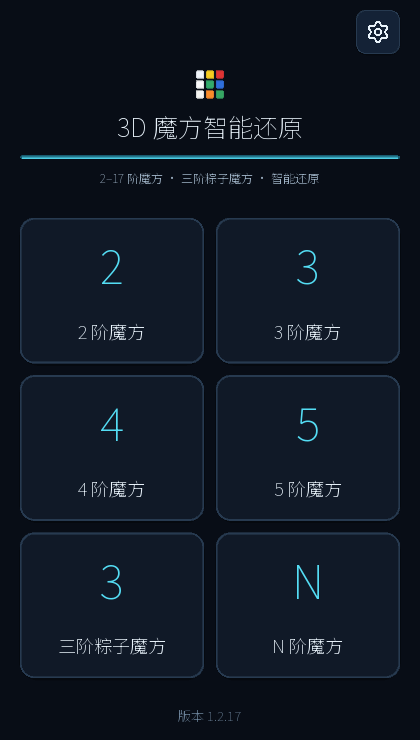
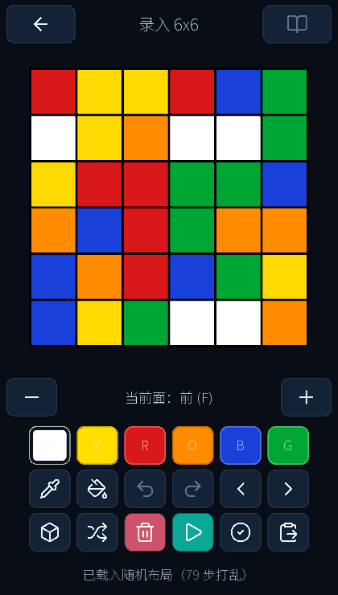
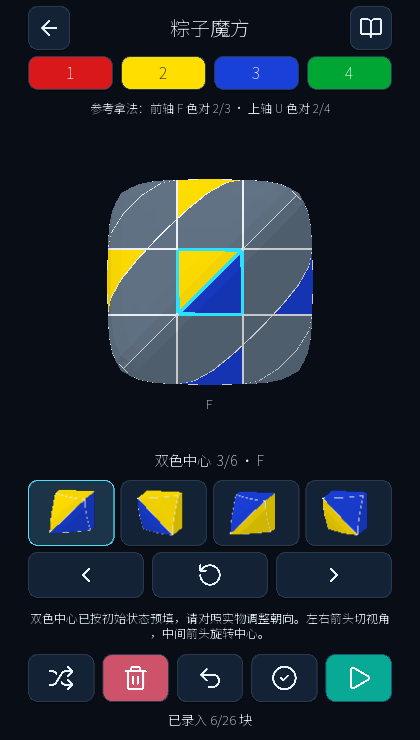
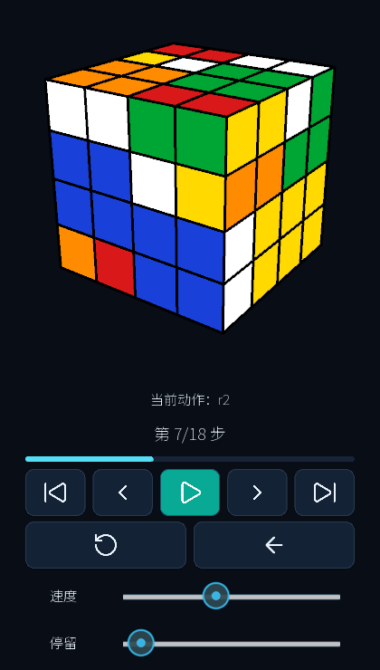
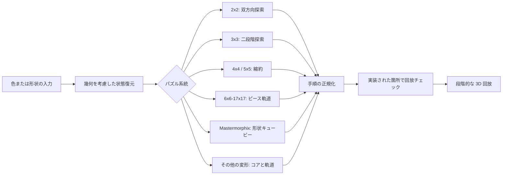

# 3D Cube Solver

### 通常・高次・変形ツイスティパズルの状態ベース解法

[Windows / Android 版](https://github.com/coco54-beep/cube-solver/releases/latest) · [English](README.md) · [中文技术说明](README.zh-CN.md) · [ソースコード](https://github.com/coco54-beep/cube-solver)

## 1.2.23 の更新

- 通常のキューブと対応する変形パズルに写真読み取りを追加。**読み取りは5段以下**に制限します。通常の N 次求解は引き続き **6〜17段**に対応します。
- Skewb、Dino / Lattice、Clover、Eight-petals、Ivy、Void Cube、Pandora、Pyraminx、Tower / Void Tower、面回転八面体、**二十面体の2〜5段**、Megaminx、Blossom、32面 Football / Tuttminx に対応。モデルのステッカー輪郭から色を読み、空洞を除外します。
- 頂点と切れ目を合わせ、モデルの全体回転アニメーションに従って面を切り替えます。不確かな色はモデル上で修正でき、色の校正は手動修正を保持して撮影済みの面を更新します。二十面体は20色、Footballは32色の参照番号を使います。
- Android のシステム写真選択画面に対応し、カメラ映像と選択枠の位置を修正しました。**新しい変形テンプレートの実写精度は未検証です。** 鏡面、形状が変わる外形、曲面、ジャンブリング状態は固定平面テンプレートの対象外です。

**Android arm64-v8a：** [1.2.23 試用 APK](https://github.com/coco54-beep/cube-solver/releases/download/v1.2.23/cubesolver-1.2.23-arm64-v8a-debug.apk)。**Windows x64：** [1.2.23 のリリース資産](https://github.com/coco54-beep/cube-solver/releases/tag/v1.2.23)からポータブル ZIP を取得し、全体を展開して `_internal` を残してください。

[1.2.23 リリースノート](docs/release-1.2.23.md) · [写真読み取りの対応表と手順](docs/photo-scan.md) · [Windows ビルド手順](docs/windows.md)

## 1.2.22 の更新

- 通常の N 次キューブは **6〜17 段**。中心の候補は解全体で比較し、Mastermorphix と Mirror Cube の 4〜9 段はピース形状を保持して短い準備手順を選びます。
- Football は辺の反転をペアで処理。高次 Megaminx はコンパクトな探索状態、一括評価、検証済みの軌道データを利用します。変形パズルには完全な作用が等しい手順の書き換えと、重複状態の除去を追加しました。
- 形状キューブは本体と可視中心の向きを合計で評価。Square-1 と Mirror Tower は時間制限内で二段階の総手数を比較します。5 段以下の完全な復元デモも利用できます。
- **90 種類／段数の入力状態が完全再生チェックを通過し、299 件の解法・デモ検査に合格しました。** [最適化レポート](reports/algorithm-upgrades/2026-10-13/report.md)にはサンプルと制限を記載しています。すべての入力で手数が減るとは限りません。

**Windows x64：** [CubeSolver-1.2.22-windows-x64.zip](https://github.com/coco54-beep/cube-solver/releases/download/v1.2.22/CubeSolver-1.2.22-windows-x64.zip) をダウンロードし、全体を展開して `CubeSolver/CubeSolver.exe` を起動してください。隣の `_internal` フォルダーを残します。Python のインストールは不要です。Android APK は[リリースページ](https://github.com/coco54-beep/cube-solver/releases/tag/v1.2.22)に掲載されます。

[リリースノート](docs/release-1.2.22.md) · [Windows ビルド手順](docs/windows.md)

## 概要

本プロジェクトは、入力されたパズル状態をモデル化し、パズルごとの検証と回放チェックを伴う手順列を生成します。通常の 2×2〜5×5 と実験的な 6×6〜17×17 に加え、現行版（1.2.23）は幅広い変形パズルを収録します：形状変化した Mastermorphix / Mirror Cube 系（2〜9段）、Pyraminx（2〜7）、Skewb（3/5/7）、Megaminx（2〜13）、Tower Cube（3〜7）、Dino / Lattice（2/4/6）、面回転八面体（2〜4）、Football / Tuttminx（3/5）、Icosahedron（2〜5）、Blossom、Ivy、Clover、Eight-petals、Void Cube / Tower、Square-1、Mirror Tower、ウォードラム（2〜5）、五面体（2〜5）、および形状キューブ（Axis / Pandora / Windmill / Fisher）。各系統は、すべてを通常の 3×3 表現に押し込むのではなく、幾何に基づく状態モデルを使います。変形カタログは、専用ディレクトリ内の図付きカードとして表示されます。

エンジニアリングの重点は、入力から回放までの一連の流れです：幾何キュービー表現、状態検証、解法の段階制御、手順の正規化、解のチェック。本プロジェクトは適切な箇所で既存の解法を取り込んでおり、キューブ群に対する新しい一般解や大域的最短解を主張するものではありません。高次の解法は実験的で、ランダム状態や Android 実機での網羅的な評価は未完了です。

**キーワード：** 置換パズル；キュービーモデル；縮約法；ピース軌道；交換子；Mastermorphix；Pyraminx；Skewb；Megaminx；Mirror Cube；解の検証

<p align="center">
  
  
  
  
</p>

<p align="center"><sub>図 1：パズル選択、高次入力、形状を考慮した入力、3D 回放。1.2.22 は図付きカードの変形パズルディレクトリと、幾何ごとの回転・回放画面を追加。</sub></p>

## 1. 対象範囲と貢献

本アプリは 4 つの課題を扱います：入力された色やピース形状からの状態解釈；どの段数も 3×3 として扱うのではなくパズル固有の解法を選ぶこと；非立方体機構のための幾何を考慮した回転と回放；そして段階的な手順と回放チェックによる信頼できる提示。プロジェクトの貢献には、共有の幾何ピースモデル、自作の 2×2 探索、4×4 / 5×5 の縮約解法、軌道ベースの 6×6〜17×17 パイプライン、段数対応の Mastermorphix モデル、Pyraminx / Skewb / Megaminx / Tower Cube / Mirror Cube の幾何エンジンが含まれます。3×3 の二段階探索は同梱の `hkociemba` 実装を利用し、本プロジェクトがラップしています。

1. **状態解釈。** 面色と形状ピースの向きを、スクランブル履歴に依存せず検証できる明示的な状態へ変換します。
2. **パズル固有の解法。** すべての段数を 3×3 探索問題として扱わず、パズル系統ごとに適した解法構成を選びます。
3. **信頼できる提示。** 段階を保持し、人が読める手順を出力し、全状態チェックを実装した解法では完成した解を回放で検証します。

プロジェクトの貢献は主に実装と統合です：共有の幾何キュービーモデル、自作の 2×2 双方向探索、4×4 / 5×5 の縮約解法、軌道ベースの 6×6〜17×17 パイプライン、4 色 Mastermorphix の状態と専用解法。3×3 の二段階探索は同梱の `hkociemba` 実装を利用し、本プロジェクトがラップしています。

## 2. 状態モデルと求解パイプライン

中核モデルは、ピースをホーム座標・現在座標・可視ステッカーの向きで表します。これにより、同じ色でも位置や向きが意味を持つピースを区別できます。面色入力は求解前にこのモデルへ変換されます。奇数段では中心の色を使って、記録されたスクランブルに依らず面ラベルを正規化できます。

各求解は概ね次の流れに従います：

```text
面色 / 形状を考慮した入力
          -> キュービー状態と合法性チェック
          -> パズルごとの求解段階
          -> 正規化された手順列
          -> 回放検証（実装されている箇所）
          -> 段階的な 3D 回放
```

求解段階は単なる文字列ではなく構造化データとして返されます。これにより、界面が進捗を説明し回放できる一方で、数学的な状態を描画や入力ウィジェットから分離できます。



<p align="center"><sub>図 2：共有の状態パイプラインとパズルごとの解法バックエンド。</sub></p>

## 3. パズル系統ごとの解法

### 3.1. 2×2：コーナー状態探索

2×2 は 8 個のコーナーだけで、辺や中心はありません。解法は各コーナーの同一性と向きを 8 スロットに符号化します。半回転計量（90°・逆 90°・180° を各 1 手）で、入力状態と完成状態の両側から双方向幅優先探索します。実装は現在の小さい方の前線を展開し、同一面の連続回転や交換可能な対面の冗長順序を枝刈りします。

これは 2×2 の状態空間に特化した小さな解法です。時間制限付きで、両探索が出会うと解を返します。大域的最短は主張しません。

### 3.2. 3×3：二段階探索

3×3 の面色状態は、二段階解法に必要なキュービー座標へ変換されます。第一段階は、コーナーと辺の向きが解消され、4 つの中層辺が所定のスライスに入る部分群へ到達します。第二段階はその部分群内で解きます。探索前にキュービーモデルで入力の合法性を確認します。

探索エンジンは同梱の `hkociemba` / Kociemba 二段階実装です。本プロジェクトは面色→キュービー変換、状態検証、手順解析、アプリ統合を提供し、二段階法を独自アルゴリズムとして提示しません。実用的な解を求めるもので、大域的最短の証明ではありません。

### 3.3. 4×4：奇偶処理を伴う縮約

4×4 は縮約パイプラインに従います：

1. 6 面の中心ブロックを揃える。
2. 12 本の論理辺をなすウィングをペアリングする。
3. 3×3 には現れない縮約の奇偶（OLL / PLL 型を含む）を検出・修復する。
4. 縮約状態を 3×3 の面色状態へ変換し、3×3 エンジンで解く。

中心の解き方によって複数の妥当な縮約があり得ます。実装は中心・配辺・奇偶前置の圧縮長で候補を比較し、選んだ縮約 3×3 を解きます。合成した段階を元の立方体のコピーに適用し、成功報告前に 4×4 の完全な状態を検査します。最後に同じ面の等価性で記号を圧縮します。

### 3.4. 5×5：中心・三片辺・向きの縮約

5×5 はまず中心色を解き、色の一致をピース同一性と見なさないよう十分なピース情報を保持します。次にマクロベースの辺縮約プランナで、各論理辺を中辺と 2 つのウィングから組み立てます。専用の中辺向き段階が、縮約 3×3 表現を無効にしうる内部向き制約を解消します。

縮約後、状態を 3×3 に変換し共有の二段階解法へ渡します。手順は同軸スライスの等価回転で簡略化し、元の 5×5 モデルで回放し、完全に揃ったかを検査します。高速な中心 / 辺縮約経路が失敗した場合の有界なフォールバックも備えますが、これはロバスト性の仕組みであり、短い / 最適な結果の保証ではありません。

### 3.5. 6×6〜17×17：独立ピース軌道による求解

高次では、すべてのステッカーを 1 つの 3×3 へ直接縮約しません。コーナーと（奇数段では）中央辺ピースから 3×3 コアを抽出して解き、残りのピースを合法回転の下での幾何軌道ごとに処理します。

実装はウィング軌道と中心軌道を識別し、可視ピース同一性と奇偶制約を検証し、各軌道を置換で表します。これらの置換から三循環を分解します。交換子に似た基本手順を共役で目標位置へ移動し、層回転へ展開し、等価な記号へ圧縮します。ウィング軌道を中心軌道より先に処理し、後続の中心操作が許容される副作用を吸収できるようにします。完全な手順列は入力のコピーで回放し、作業状態と回放状態の両方が揃ったときだけ返します。

本手法は 6〜17段に実装されています。この範囲はソフトウェアの能力であり、状態空間を網羅的に検証した主張ではありません：広範なランダム状態の網羅、性能ベンチマーク、Android 実機検証は未完了です。詳しくは [N×N 実装ノート](docs/nxn.md)。

### 3.6. 2〜9段 Mastermorphix：形状と向きのモデル

Mastermorphix 系は 2〜9段をサポートします。3 段は形状ピースを持つ立方体機構としてモデル化されます：8 個のコーナー類ピース、12 個の単色辺ウェッジ、6 個の 2 色中心接合。入力と検証は形状を考慮します。内部では仮想 6 色ラベルにより可動ピース構成を通常の 3×3 状態へ写像します。このラベルは解法の帳簿付けであり、ユーザー入力は不要です。

解法はまず可動ピースの 3×3 解を求めます。Mastermorphix は中心の向きを露出するため、可動ピースを変えないことを確認した中心専用生成子を適用します。適切な全体回転が等価なマクロ向きを生成し、利用可能な中心マクロ集合上の最短経路表が、到達可能な 2,048 個の中心向き状態を覆います。有界のベストエフォート探索が、等価なピースラベリング・準備回転・マクロ順序を比較して手数を減らします。最終手順は形状を考慮したモデルで回放し、ピース配置と可視向きの両方を解く必要があります。

3 段以外は対応するコーナー状態または高次キュービー解法を使い、形状モデルで検証します。3 段の有界最適化は最小性の証明ではありません。詳しくは [Mastermorphix モデルと使用ノート](docs/mastermorphix.md)。

### 3.7. 変形パズル系統：幾何ごとの状態と回転

専用の変形パズルディレクトリは、多段系統を個別カードに、単一規格のパズルを別の「特殊」コレクションにまとめ、各カードにレンダリングした 3D 図を表示します。下の段数範囲はアプリが提示する選択肢で、各幾何は独自の合法層回転モデルを持ちます。

| 系統 | 段数 | 状態表現と求解経路 |
|---|---:|---|
| Pyraminx | 2-7 | 四面体ステッカー幾何。2 層版は 4 つの可動チップを別扱いし、高次は小さなコアを解いてから残りのピース軌道を解く。 |
| Skewb | 3, 5, 7 | 頂点回転幾何。ステッカー状態入力からコアと軌道縮約で解く。 |
| Megaminx | 2-13 | 12 面十二面体幾何。2〜3 段は事前計算した強生成列（SGS）、高次は縮約コアと三循環搬送でピース軌道を処理。偶数段は対応する Kilominx 機構。 |
| Tower Cube | 3-7 | 四面体タワー幾何。独自の層回転置換と形状を考慮した回放。 |
| Mirror Cube | 2-9 | 色ではなくピースの寸法と向きで入力。対応する 2×2 / 3×3 / 高次エンジンで正確なピース同一性を解く。 |
| Mastermorphix | 2-9 | 4 色の形状ピースモデル。3 段は中心の向きを明示的に追跡し、他段は対応するキュービー解法を使う。 |
| Dino / Lattice | 2, 4, 6 | 8 本の角軸で 120° 回転。Dino は 12 本の 2 色辺、Lattice は内外層を追加。コアと軌道縮約で解く。 |
| 面回転八面体（FTO） | 2-4 | 8 つの三角面が面軸で回転。小さなコアと共役三循環搬送で解く。 |
| Football / Tuttminx | 3, 5 | 32 面の球体：五角形は 72°、六角形は 120°。 |
| Icosahedron | 2-5 | 20 の三角面。縮約コアと軌道ベースの三循環。 |
| Blossom Megaminx | 3 | 辺のみ 180° 回転。花びらは辺に従い、面中心は固定。 |
| Ivy | 3 | 4 つの角が 120° 回転し、隣の葉中心を動かす。 |
| Clover | 3 | 辺の 180° 回転。半回転で生じる状態も含む。 |
| Eight-petals | 3 | 角の 120° 回転。 |
| Void Cube | 3 | 固定面中心を持たない 3×3 機構。 |
| Void Tower | 3 | Void Cube のタワー変種。 |
| Square-1 | - | 切断パズル。形状と色を入力し、中層の反転を含む。 |
| Mirror Tower | - | 色を使わずピース寸法のみの入力。 |
| ウォードラム | 2-5 | 8 本の 120° 面軸（大きな六角形 4、小さな三角形 4）。 |
| 五面体 | 2-5 | 三角柱：側面 3 軸が 180°、三角面 2 軸が 120°。 |
| 形状キューブ（Axis / Pandora / Windmill / Fisher） | 3 | 3×3 機構に形状変化した外殻。 |

多面体エンジンはパズル幾何からステッカー置換を導き、スクランブル履歴なしで状態を復元し、生成した手順を回放で確認します。別の回転画面で軸と層を選び、手動回転・元に戻す / やり直す・視点ロックができます。回放は元の幾何を保ち、ステップ移動・速度・停止時間の調整を提供します。入力規約、段数の詳細、実装上の制限は [変形パズルのモデルと使用ノート](docs/irregular-puzzles.md)。

## 4. 検証と確認

検証層は各パズルに関係する構造を確認します：ステッカー数と面寸法、幾何固有の合法回転軌道、固定中心の規約、コーナーと辺の同一性 / 向き、高次の軌道整合性、Mirror Cube のピース形状、Mastermorphix の形状と中心向き。文法的に完全な色配置でも、物理的に到達可能な状態とは限りません。

確認の閾値は解法ごとに異なります。4×4 は求解段階の適用後・最終記号の圧縮前に完全な状態を検査します。5×5・N×N・Mastermorphix は最終手順を入力のコピーで回放し、完成状態を要求します。3×3 は探索前に状態合法性を確認し、2×2 はコーナー状態符号化を使います。この 2 つは現状、同じ完全モデル回放チェックを行いません。すべての手法で、返す手順列は本アプリの記号とシミュレータ向けです。

## 5. アプリと再現

解法は Python / Kivy アプリに統合され、色または形状の入力、ランダムスクランブル、記法の貼り付け、検証、元に戻す / やり直す、キャンセルと進捗表示、変形パズル用の専用回転練習、段階的な 3D 回放を提供します。Android arm64-v8a パッケージとデスクトップ Python プログラムがあります。

```bash
git clone https://github.com/coco54-beep/cube-solver.git
cd cube-solver
python -m pip install -r requirements.txt
python run_desktop.py
```

Python 3.10 以降が必要です。4×4 の解法表が無い場合は Git LFS を導入し `git lfs pull` を実行してください。最新の Android 版は [GitHub Releases](https://github.com/coco54-beep/cube-solver/releases/latest) で公開しています。

## 6. 制限と評価状況

本 README は実装したアルゴリズムと確認ゲートを説明するもので、管理されたベンチマーク結果は報告しません。上記の最適化レポートにはデスクトップでのサンプルと手数比較を掲載していますが、管理された機種横断の時間計測はありません。特に 6×6〜17×17 と新たな変形系統は、網羅的なランダム状態の検証や機種横断の Android 性能評価を受けていません。Mastermorphix の手数探索は有界でヒューリスティックです。3×3 の二段階解法と 2×2 の双方向探索は、大域的最適解法として提示しません。

## 参考と実装ノート

1. Herbert Kociemba, [The Two-Phase Algorithm](https://kociemba.org/math/twophase.htm)。同梱の 3×3 解法を通じて使用。
2. Chris Hardwick, [Wing-orbit parity](https://www.speedcubing.com/chris/lemma2.html) と [center-orbit three-cycles](https://www.speedcubing.com/chris/lemma3.html)。高次軌道構成の数学的背景；コードは独自の座標と回転モデルを実装。
3. Jaap Scherphuis, [Rubik's Cube variants, including Mastermorphix](https://www.jaapsch.net/puzzles/cubevari.htm) と [Supergroup theory](https://www.jaapsch.net/puzzles/theory.htm)。形状キューブと向き付き中心の背景。
4. [N×N 求解ノート](docs/nxn.md) · [Mastermorphix ノート](docs/mastermorphix.md) · [変形パズルノート](docs/irregular-puzzles.md) · [ソースコード](https://github.com/coco54-beep/cube-solver)

本プロジェクトは [GNU General Public License v3.0](LICENSE) の下で配布されます。同梱の二段階解法はソース内に帰属を明記し、それぞれのライセンス条件で配布されます。
