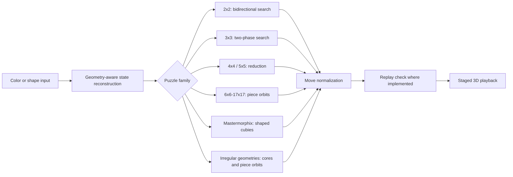

# 3D Cube Solver

### A state-based solver for standard, higher-order, and irregular twisty puzzles

[Windows and Android downloads](https://github.com/coco54-beep/cube-solver/releases/latest) · [中文技术说明](README.zh-CN.md) · [日本語](README.ja.md) · [Source code](https://github.com/coco54-beep/cube-solver)

## 1.2.32 update

- Fixed a piece-frame regression introduced by the appearance-layer field: Mastermorphix, Ghost and Mirror shape pieces were constructed with their frame stored in the wrong field. This broke scramble initialization and center-orientation solving across many shape variants.
- Restored correct frame handling for Mastermorphix, Ghost Cube/floppy, and the Mirror shape family; all regression tests now pass again.

[1.2.32 release notes](docs/release-1.2.32.md)

## 1.2.31 update

- **Cuboid series**: 3×3×2 Rubik's Domino, 2×2×3 Slim Tower, 3×3×4, 2×2×4 Rubik's Tower, 4×4×2, 2×3×4, 1×3×3 Super Floppy, 3×3×5 and 4×4×6. Super Floppy uses a complete 3,041,280-state shortest-distance table.
- **New families**: Circle / Crazy Planet (Circle 2×2 plus eight planets), bandaged/fused cubes (Fused, Two-Bar, Bandaged C, BiCube, AI, Burr, Camouflage), Penrose 2×2/3×3/4×4, and Circle 2×2.
- **New special puzzles**: Super Ivy, Mosaic, Tins, Dino Skewb, Dayan Dino Skewb, Fisher Skewb, Pyraminx Duo, Ghost Pyramid, Coin Tetrahedron, Helicopter and order-5 FTO.
- **Algorithm and UI work**: app scrambles keep a legal inverse path for long reduction puzzles (about 30 moves instead of 100–450), Petal Tetrahedron solutions are shortened, SQ playback/randomization crashes are fixed, and new geometry/appearance layers are included for the added variants.
- **Verification**: new solver and UI regression tests cover the added families; see the release notes for current known limitations.

[1.2.31 release notes](docs/release-1.2.31.md)

## 1.2.30 update

- **New irregular families**: Petal Tetrahedron / Icosahedron (with and without centres), SQ-0, SQ-2, Super SQ-1, Mirror Windmill/Fisher unequal-height and offset-cut variants, Ghost Cube, Skewb Ultimate, Void Megaminx, Four-Colour Dino, plus order-4 Axis/Windmill/Fisher cubes.
- **Solver improvements**: dedicated Skewb Ultimate (typically 9–12 moves), full-state Mirror Skewb (10–11), SQ-2 parity/layer-turn reduction (about 246 moves on average), Super SQ-1 multi-start alignment search, and shortened petal macros that solve petals first and centres last. Every solution is replay-checked.
- **UI / i18n**: new cards, three-language labels, help and About text for the new families; safe theme access during screen construction and a UIButton refresh fix.
- **Quality**: 1,413 tests passed and 4 skipped; the new solvers were benchmarked on desktop.

[1.2.30 release notes](docs/release-1.2.30.md)

## 1.2.27 update

- **Unified solving page** for standard cubes, irregular puzzles and Square-1: model, stage progress and Cancel; cancellation preserves input, errors use one presentation, and late results cannot redirect the UI.
- **Shared camera controls** across input, turning and playback: locking sets follow to zero; enabling follow unlocks the view; resetting the camera preserves these settings.
- **Consistent buttons**: prevent overlapping edits during animation, pause autoplay on manual steps and before navigation confirmations, and retain undo history for bulk entry, scrambles and returning from turning.
- **Android fixes**: lightweight scramble imports preserve entered data on failure; include the missing bundled `twophase` modules to prevent `No module named 'twophase.defs'`.
- New UI changes received syntax and package-content checks, without phone regression testing. Earlier module fixes passed 3×3 and order-seven Pyraminx solve/replay checks in the emulator.

[1.2.27 release notes](docs/release-1.2.27.md) · [Windows / Android downloads](https://github.com/coco54-beep/cube-solver/releases/latest)

## 1.2.26 update

- Fixes the **Help** dialog on phones: the panel now scales with the screen (it was capped at ~760×560 raw pixels) and the text uses density-aware sizes (18/21/26 sp), so it is readable on high-resolution devices.

**Downloads:** [Android arm64-v8a APK](https://github.com/coco54-beep/cube-solver/releases/download/v1.2.26/cubesolver-1.2.26-arm64-v8a-release.apk) · [Windows x64 portable ZIP](https://github.com/coco54-beep/cube-solver/releases/download/v1.2.26/CubeSolver-1.2.26-windows-x64.zip). Extract the Windows ZIP completely and retain `_internal`.

[1.2.26 release notes](docs/release-1.2.26.md) · [All releases](https://github.com/coco54-beep/cube-solver/releases/latest)

## 1.2.25 update

- **Photo scan** now follows the input page's face order (F→R→U→B→L→D), shows which way to turn the cube, overlays an alignment guide, and lets you apply a partial scan; the camera preview is auto-oriented to the device.
- Every input page replaces its redundant **Validate** button with a one-tap **Set initial** that resets the puzzle to the solved state; shape / Mirror / Mirror Tower pages pre-place their centre pieces for easier alignment.
- Home gains a bottom action bar (Σ formula library · camera · settings) with matching icon buttons; the Help dialog now scales to the screen and documents the formula library, practice and photo scanning.
- Scrambles scale with puzzle size (higher-order Megaminx / Football) and the Blossom Megaminx scrambles longer; solution-failure messages are localised.
- Engineering: an in-app UI smoke self-check with screenshot-baseline regression, a device self-check over ADB, and an i18n coverage audit.

**Downloads:** [Android arm64-v8a APK](https://github.com/coco54-beep/cube-solver/releases/download/v1.2.25/cubesolver-1.2.25-arm64-v8a-release.apk) · [Windows x64 portable ZIP](https://github.com/coco54-beep/cube-solver/releases/download/v1.2.25/CubeSolver-1.2.25-windows-x64.zip). Extract the Windows ZIP completely and retain `_internal`.

[1.2.25 release notes](docs/release-1.2.25.md) · [All releases](https://github.com/coco54-beep/cube-solver/releases/latest)

## 1.2.24 update

- Adds an offline advanced algorithm library for 2–5-layer cubes, Square-1, Skewb, Pyraminx and 3-layer Megaminx: **43 consolidated sets and 6,060 playable cases**, with prerequisites, alternatives and native 3D playback. Source attribution is a plain label.
- Practice covers 2×2, 3×3, Square-1 and Pyraminx, with selectable sets, randomized holds/alignment, preferred algorithms, learning status and weak-case prioritization. Scrambles appear directly on the practice screen; 2×2/3×3/Square-1 attempt independently generated setups in the background and retain a legal fallback on timeout.
- Adds OK/+2/DNF, ao5/ao12 and recent results. Viewing the answer before finishing excludes that attempt. Playback uses the actual current question.
- Native formula finishes can shorten 3×3, Megaminx and Square-1 solutions; candidates are accepted only after full replay and a lower total move count. Fixes consecutive parenthesized Square-1 turns in displayed scrambles.

**Downloads:** [Android arm64-v8a APK](https://github.com/coco54-beep/cube-solver/releases/download/v1.2.24/cubesolver-1.2.24-arm64-v8a-debug.apk) · [Windows x64 portable ZIP](https://github.com/coco54-beep/cube-solver/releases/download/v1.2.24/CubeSolver-1.2.24-windows-x64.zip). Extract the Windows ZIP completely and retain `_internal`. The Android APK uses the existing local debug signing key.

[1.2.24 release notes](docs/release-1.2.24.md) · [Advanced library and practice](docs/advanced-formula-library.md)

## 1.2.23 update

- Adds photo scanning for standard cubes and suitable irregular puzzles, **up to order five**. This limit applies to scanning; standard N-order solving still covers **6–17**.
- Supports Skewb, Dino/Lattice, Clover, Eight-petals, Ivy, Void Cube, Pandora, Pyraminx, Tower/Void Tower, face-turning octahedra, **Icosahedron orders 2–5**, Megaminx, Blossom, and 32-face Football/Tuttminx. Scanning samples the actual sticker polygons and skips holes.
- Align the face vertices and cuts, follow the whole-puzzle turn animation, and correct uncertain stickers on the small model. Photo color calibration updates previously scanned faces while keeping manual corrections; Icosahedron and Football expose 20 and 32 color references.
- Android uses the system photo picker and matches the camera preview to the selection frame. **Real-photo accuracy for the newly added irregular profiles has not yet been validated.** Mirror finishes, changing silhouettes, curved shells, and jumbling states are outside these fixed-face templates.
- **Hint.** Open a puzzle, tap the camera icon, aim one whole face into the on-screen guide box, and capture (or import a photo). The Android build opens the system photo picker, so no gallery permission is required; correct any uncertain sticker on the small model before applying.

**Android arm64-v8a:** [1.2.23 APK for testing](https://github.com/coco54-beep/cube-solver/releases/download/v1.2.23/cubesolver-1.2.23-arm64-v8a-debug.apk). **Windows x64:** see the [1.2.23 release assets](https://github.com/coco54-beep/cube-solver/releases/tag/v1.2.23) for the portable ZIP; extract it completely and retain `_internal`.

[1.2.23 release notes](docs/release-1.2.23.md) · [Supported photo profiles and workflow](docs/photo-scan.md) · [Windows build instructions](docs/windows.md)

## 1.2.22 update

- Standard N-order cubes cover **6–17**. Centre strategies are compared using the complete solution; Mastermorphix and Mirror Cube 4–9 retain exact shape identities while comparing shorter setups.
- Football uses paired edge flips. High-order Megaminx uses compact search states, batch scoring, and verified precomputed orbit plans. More irregular families receive equivalent-action rewriting and repeated-state removal.
- Shape cubes compare body and visible centre orientation together; Square-1 and Mirror Tower compare complete two-stage paths within a time budget. Existing solver-backed demonstrations through order five remain available.
- **90 type/order configurations passed complete entered-state replay**, with 299 targeted solver and demonstration checks passing. Samples and limits are documented in the [optimization report](reports/algorithm-upgrades/2026-10-13/report.md); shorter solutions are not guaranteed for every input.

**Windows x64:** download [CubeSolver-1.2.22-windows-x64.zip](https://github.com/coco54-beep/cube-solver/releases/download/v1.2.22/CubeSolver-1.2.22-windows-x64.zip), extract the complete archive, and open `CubeSolver/CubeSolver.exe`. Keep the `_internal` folder beside the executable. Python installation is unnecessary. Android APKs are listed on the [release page](https://github.com/coco54-beep/cube-solver/releases/tag/v1.2.22).

[Release notes](docs/release-1.2.22.md) · [Windows build instructions](docs/windows.md)

## Abstract

This project models entered puzzle states and produces move sequences with puzzle-specific validation and replay checks. In addition to conventional 2x2-5x5 cubes and an experimental 6x6-17x17 solver, the current release (1.2.31) covers a broad irregular catalog: the shape-modified Mastermorphix and Mirror Cube families (orders 2-9), Pyraminx (2-7), Skewb (3/5/7), Megaminx (2-13), Tower Cube (3-7), Dino/Lattice (2/4/6), Face-turning Octahedron (2-4), Football/Tuttminx (3/5), Icosahedron (2-5), Blossom, Ivy, Clover, and Eight-petals, Void Cube/Tower, Square-1, Mirror Tower, War Drum (2-5), Pentahedron (2-5), and the shape cubes (Axis, Pandora, Windmill, Fisher). Each family uses a geometry-aware state model rather than forcing every shape through a conventional 3x3 representation. The irregular catalog is presented as illustrated cards in a dedicated directory.

The 1.2.30 update adds the petal tetrahedron/icosahedron, SQ-0/SQ-2/Super SQ-1, unequal-height and offset-cut mirror variants, Ghost Cube, Skewb Ultimate, Void Megaminx, four-colour Dino and order-4 shape cubes. 1.2.31 adds the cuboid, circle/crazy-planet and bandaged families plus the new special puzzles listed above.

The engineering focus is the complete path from input to replay: geometric cubie representation, state validation, solver orchestration, move normalization, and solution checking. The project integrates established solving methods where appropriate; it does not claim a new general solution to the cube group or globally optimal solutions. Higher-order solving remains experimental and has not been comprehensively benchmarked across random states and Android devices.

**Keywords:** permutation puzzles; cubie model; reduction method; piece orbits; commutators; Mastermorphix; Pyraminx; Skewb; Megaminx; Mirror Cube; solution verification

<p align="center">
  
  
  
  
</p>

<p align="center"><sub>Figure 1. Puzzle selection, higher-order input, shape-aware input, and 3D playback. The 1.2.24 release adds an offline advanced formula library with practice mode, photo scanning, and a full irregular-puzzle directory with illustrated cards and geometry-specific twist and playback screens.</sub></p>

## 1. Scope and contributions

The application addresses four related problems: state interpretation from entered colors or piece shapes; puzzle-specific solving instead of treating every order as a 3x3; geometry-aware turning and playback for non-cubic mechanisms; and reliable presentation through staged moves and replay checks. The project contributions include shared geometric piece models, a custom 2x2 search, reduction solvers for 4x4 and 5x5, an orbit-based 6x6-17x17 pipeline, an order-aware Mastermorphix model, and a geometric engine for Pyraminx, Skewb, Megaminx, Tower Cube, and Mirror Cube. The 3x3 two-phase search is provided by the bundled `hkociemba` implementation and is wrapped by this project.

1. **State interpretation.** Convert face colors and shaped-piece orientations into an explicit state that can be checked independently of the scramble history.
2. **Puzzle-specific solving.** Select a suitable solver architecture for each puzzle family instead of treating all orders as a 3x3 search problem.
3. **Reliable presentation.** Preserve stages, emit human-readable moves, and check completed solutions by replay where the solver implements a full-state check.

The project contributions are primarily implementation and integration: a shared geometric cubie model, a custom 2x2 bidirectional search, reduction solvers for 4x4 and 5x5, an orbit-based 6x6-17x17 pipeline, and a dedicated four-color Mastermorphix state and solver. The 3x3 two-phase search is provided by the bundled `hkociemba` implementation and is wrapped by this project.

## 2. State model and solving pipeline

The core model represents a piece by its home coordinate, current coordinate, and visible sticker directions. This distinguishes pieces with identical colors when their positions or orientations matter. Facelet input is converted into this model before solving; odd-order center colors can be used to canonicalize face labels without relying on a recorded scramble.

At a high level, each solve follows this pipeline:

```text
facelet / shape-aware input
            -> cubie state and legality checks
            -> puzzle-specific solving stages
            -> normalized move sequence
            -> replay verification (where implemented)
            -> staged 3D playback
```

Solver stages are returned as structured data rather than a flat string. This allows the interface to explain progress and replay the result while keeping the mathematical state separate from rendering and input widgets.



<p align="center"><sub>Figure 2. Shared state pipeline with puzzle-specific solver back ends.</sub></p>

## 3. Methods by puzzle family

### 3.1. 2x2: corner-state search

A 2x2 has eight corner pieces and no edge or center pieces. The solver encodes each corner by identity and orientation in one of eight slots. It searches in the half-turn metric (a quarter turn, inverse quarter turn, or half turn each costs one move) using bidirectional breadth-first search from the input and solved states. The implementation expands the smaller current frontier and prunes consecutive turns of the same face and redundant opposite-face orderings.

This is a compact solver specialized to the 2x2 state space. It is time-bounded and returns a solution when the two searches meet; the implementation does not claim globally optimal solutions.

### 3.2. 3x3: two-phase search

The 3x3 facelet state is converted to the cubie coordinates required by the two-phase solver. Phase one reaches the subgroup in which corner and edge orientations are resolved and the four middle-slice edges occupy their designated slice. Phase two solves within that subgroup. Input legality is checked using the cubie model before search.

The search engine is the bundled `hkociemba` / Kociemba two-phase implementation. This project supplies the facelet-to-cubie adapter, state validation, move parsing, and application integration; it does not present the two-phase method as an original algorithm. The method is designed to find practical solutions, not prove a globally shortest sequence.

### 3.3. 4x4: reduction with parity handling

The 4x4 solver follows a reduction pipeline:

1. Solve the six center blocks.
2. Pair the wing pieces that form each of the twelve logical edges.
3. Detect and repair reduction parity cases that do not occur on a 3x3, including OLL- and PLL-type parity.
4. Convert the reduced state to a 3x3 facelet state and solve it with the 3x3 engine.

Center solving can produce several valid reductions. The implementation compares candidates by the compressed length of their center, edge-pairing, and parity prefix, then solves the selected reduced 3x3. The composed stages are applied to a copy of the original cube and the complete 4x4 state is checked before success is reported. The final notation is then compressed using same-face equivalences.

### 3.4. 5x5: center, triple-edge, and orientation reduction

The 5x5 solver first solves center colors, retaining enough piece identity to avoid treating color equality as exact piece identity. It then uses a macro-based edge-reduction planner to assemble each logical edge from its middle edge and two wings. A dedicated middle-edge orientation stage resolves internal orientation constraints that would otherwise make the reduced 3x3 representation invalid.

After reduction, the state is converted to a 3x3 and passed to the shared two-phase solver. The move sequence is simplified using equivalent same-axis slice turns, replayed on the original 5x5 model, and checked for a fully solved state. If the faster center or edge-reduction path fails, the solver has bounded fallback paths; this is a robustness mechanism, not a guarantee of a short or optimal result.

### 3.5. 6x6-17x17: independent piece-orbit solving

For higher-order cubes, the solver does not reduce every sticker directly to a single 3x3. It extracts a 3x3 core from the corners and (for odd orders) the central edge pieces, solves that core, and then handles the remaining pieces by their geometric orbits under legal moves.

The implementation identifies wing and center orbits, validates their visible piece identities and parity constraints, and represents each orbit as a permutation. Three-cycles are decomposed from these permutations. Commutator-like primitive sequences are conjugated to the target locations, expanded into layer turns, and compressed into equivalent notation. Wing orbits are processed before center orbits so that later center operations can absorb their permitted side effects. The complete move list is replayed on a clone of the input and returned only if both the working state and replay state are solved.

This method is implemented for orders 6 through 17. The size range is a software capability, not a claim of comprehensive state-space validation: broad random-state coverage, performance benchmarks, and Android device validation remain incomplete. See [the N x N implementation notes](docs/nxn.md).

### 3.6. Orders 2-9 Mastermorphix: shape and orientation model

The Mastermorphix family is supported from orders 2 through 9. The order-three puzzle is modeled as a cube mechanism with shaped pieces: eight corner-class pieces, twelve single-color edge wedges, and six two-color center seams. Input and validation are shape-aware. Internally, virtual six-color labels let the movable-piece configuration be mapped to a conventional 3x3 state; these labels are solver bookkeeping and are not required from the user.

The solver first obtains a 3x3 solution for the movable pieces. Because the Mastermorphix exposes center orientation, it then applies center-only generators whose effects are checked to leave movable pieces unchanged. Proper cube rotations generate equivalent macro orientations, and a shortest-path table over the available center-macro set covers the 2,048 reachable center-orientation states. A bounded, best-effort search compares equivalent piece labelings, setup turns, and macro orderings to reduce the move count. The final sequence is replayed against the shape-aware model and must solve both piece placement and visible orientation.

Orders other than three use their corresponding corner-state or higher-order cubie solver and verify the result against the shape-aware model. The order-three bounded optimization is not a proof of minimality. See [the Mastermorphix usage and model notes](docs/mastermorphix.md).

### 3.7. Irregular puzzle families: geometry-specific state and moves

A dedicated irregular-puzzle directory groups the multi-order families as individual cards and the single-specification puzzles under a separate special collection; each card shows a rendered 3D thumbnail. The order ranges below are the choices exposed by the application; each geometry has its own legal layer-turn model.

| Puzzle family | Orders | State representation and solving path |
|---|---:|---|
| Pyraminx | 2-7 | Tetrahedral sticker geometry. The 2-layer variant models its four movable tips separately; higher orders solve a small core and then the remaining piece orbits. |
| Skewb | 3, 5, 7 | Vertex-turning geometry with sticker-state input; solved through a core and orbit-based reduction. |
| Megaminx | 2-13 | Twelve-face dodecahedral geometry. Orders 2-3 use precomputed strong generating sequences (SGS); higher orders use a reduced core and three-cycle transports for piece orbits. Even orders follow the corresponding Kilominx mechanism. |
| Tower Cube | 3-7 | A tetrahedral tower geometry with its own layer-turn permutations and shape-aware replay. |
| Mirror Cube | 2-9 | Input is based on piece dimensions and orientation rather than color; exact piece identities are solved with the matching 2x2, 3x3, or higher-order engine. |
| Mastermorphix | 2-9 | Four-color shaped-piece model. Order three tracks center orientation explicitly; other orders use their corresponding cube-state solver. |
| Dino / Lattice | 2, 4, 6 | Eight corner-axis turns of 120°. Dino has twelve two-color edges; Lattice adds inner layers. Solved through a core and orbit reduction. |
| Face-turning Octahedron (FTO) | 2-4 | Eight triangular faces turn about their face axes; solved through a small core and conjugated three-cycle transports. |
| Football / Tuttminx | 3, 5 | 32-face ball: pentagons turn 72°, hexagons 120°. |
| Icosahedron | 2-5 | Twenty triangular faces; a reduced core plus orbit-based three-cycles. |
| Blossom Megaminx | 3 | Edge turns of 180°; petals follow their edge while face centres stay fixed. |
| Ivy | 3 | Four corner turns of 120° that move adjacent leaf centres. |
| Clover | 3 | Edge turns of 180°, including states produced by half turns. |
| Eight-petals | 3 | Corner turns of 120°. |
| Void Cube | 3 | 3x3 mechanism without fixed face centres. |
| Void Tower | 3 | Tower variant of the void cube. |
| Square-1 | - | Slice puzzle with shape and color entry, including a middle-layer flip. |
| Mirror Tower | - | Piece-size input only, without color. |
| War Drum | 2-5 | Eight 120° face axes (four large hexagons, four small triangles). |
| Pentahedron | 2-5 | Triangular prism: three 180° side axes and two 120° triangular axes. |
| Shape cubes (Axis / Pandora / Windmill / Fisher) | 3 | 3x3 mechanism with a shape-modified shell. |

The polyhedral engine derives sticker permutations from the puzzle geometry, reconstructs state without a scramble history, and checks generated moves by replay. A separate twist screen lets users select an axis and layer, rotate the puzzle, undo or redo moves, and lock the view. Solution playback keeps the original geometry and provides step navigation, playback speed, and dwell-time control. See [the irregular-puzzle model and usage notes](docs/irregular-puzzles.md) for input conventions, order details, and implementation limits.

## 4. Validation and verification

The validation layer checks the structure relevant to each puzzle: sticker counts and face dimensions, legal geometry-specific move orbits, fixed-center conventions, corner and edge identities/orientations, higher-order orbit consistency, Mirror Cube piece shapes, and Mastermorphix shape and center orientation. A syntactically complete color layout is not automatically assumed to be a physically reachable state.

The verification gate differs by solver. The 4x4 path checks the full state after applying its solving stages, before compressing the final notation. The 5x5, N x N, and Mastermorphix paths replay the final sequence on a clone of the original input and require a solved state. The 3x3 path checks state legality before search, while the 2x2 path uses its corner-state encoding; neither wrapper currently performs the same full-model replay check. Across all methods, a returned move list is intended for the application's own notation and simulator.

## 5. Application and reproducibility

The solver is integrated into a Python/Kivy application with color or shape entry, random scrambles, notation paste, validation, undo/redo, cancellation and progress reporting, dedicated twist practice for irregular puzzles, and staged 3D playback. The application is available as an Android arm64-v8a package and as a desktop Python program.

```bash
git clone https://github.com/coco54-beep/cube-solver.git
cd cube-solver
python -m pip install -r requirements.txt
python run_desktop.py
```

Python 3.10 or newer is required. If the 4x4 solver table is absent, install Git LFS and run `git lfs pull`. The latest Android build is published on [GitHub Releases](https://github.com/coco54-beep/cube-solver/releases/latest).

## 6. Limitations and evaluation status

This README describes the implemented algorithms and verification gates; it does not report controlled benchmark results. Desktop samples and move-count comparisons are published in the optimization report linked above; a controlled cross-device timing study is not available. In particular, 6x6-17x17 solving and the new irregular-puzzle families have not received comprehensive random-state coverage or cross-device Android performance evaluation. The Mastermorphix move-count search is bounded and heuristic. The 3x3 two-phase solver and 2x2 bidirectional search are not presented as globally optimal solvers.

## References and implementation notes

1. Herbert Kociemba, [The Two-Phase Algorithm](https://kociemba.org/math/twophase.htm). Used through the bundled 3x3 solver.
2. Chris Hardwick, [Wing-orbit parity](https://www.speedcubing.com/chris/lemma2.html) and [center-orbit three-cycles](https://www.speedcubing.com/chris/lemma3.html). Mathematical background for the higher-order orbit construction; the code implements its own coordinate and move model.
3. Jaap Scherphuis, [Rubik's Cube variants, including Mastermorphix](https://www.jaapsch.net/puzzles/cubevari.htm), and [Supergroup theory](https://www.jaapsch.net/puzzles/theory.htm). Background for shaped-cube and oriented-center behavior.
4. [N x N solver notes](docs/nxn.md) · [Mastermorphix notes](docs/mastermorphix.md) · [Irregular-puzzle notes](docs/irregular-puzzles.md) · [Source code](https://github.com/coco54-beep/cube-solver)

This project is distributed under the [GNU General Public License v3.0](LICENSE). The bundled two-phase solver is attributed in its source and distributed under its respective license terms.
