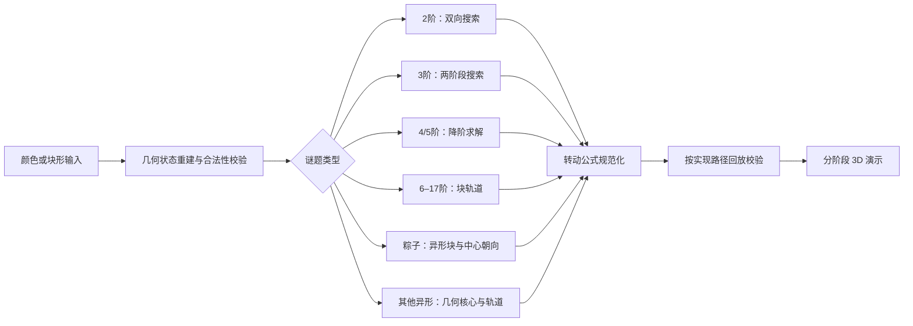

# 3D 魔方智能还原

### 面向常规、高阶与异形魔方的状态建模和求解系统

[下载 Windows / Android 版](https://github.com/coco54-beep/cube-solver/releases/latest) · [English technical overview](README.md) · [日本語](README.ja.md) · [源代码](https://github.com/coco54-beep/cube-solver)

## 1.2.34 更新

- 无历史手动求解现覆盖 **Fused、AI、Burr、Bandaged C、Two-Bar、BiCube**，以及 **Circle 2／疯狂星球** 和 **Tangram／Tangram Extreme**。
- 录入校验补充二至五阶角块/棱块翻转、扭转、奇偶和轨道约束；审计发现的二阶及高阶误接受输入现在会被拒绝。
- 重新测试了输入按钮、颜色选择、块选择、Mixup 内棱组合和棱角配对。
- 全部自动化测试通过：**2225 passed, 8 skipped**。

[1.2.34 更新说明](docs/release-1.2.34.md)

## 1.2.33 更新

- **Mixup 系列**：Mixup 3×3、3×3×4、3×4×4、4×4×4 及 Mixup Plus 变体，各自带几何感知的外形/核心降阶求解流程。Plus 3×4×4 不再因外形搜索达到上限而直接失败，可从部分外形帧继续收尾；内棱翻转收尾已对所有 Plus 型号启用。
- **新增异形**：七巧板（Tangram）与七巧板极限（Tangram Extreme）、O2、五角星（Pentacle）、古币（Ancient Coin），并加入 Penrose、Pandora 录入界面。
- **录入与调色板**：六视图直接录入、块调色板与魔方调色板界面，以及新系列的铰接观测录入。
- **修复**：包含 1.2.32 的形状块画面框回归修复，并补齐新系列的日语界面/弹窗文案。

[1.2.33 发布说明](docs/release-1.2.33.md)

## 1.2.32 更新

- 修复外观层字段引出的块坐标系回归：Mastermorphix、Ghost 和镜面异形块在构造时把 `frame` 写进了错误字段，导致大量异形的打乱初始化和中心方向求解失败。
- 恢复 Mastermorphix、Ghost Cube/软糖及镜面异形系列的坐标处理；全部回归测试已恢复通过。

[1.2.32 更新说明](docs/release-1.2.32.md)

## 1.2.31 更新

- **长方体系列**：3×3×2 多米诺、2×2×3 细塔、3×3×4、2×2×4 魔塔、4×4×2、2×3×4、1×3×3 Super Floppy、3×3×5、4×4×6。Super Floppy 使用完整的 3,041,280 状态最短距离表。
- **新增系列**：Circle／疯狂星球（Circle 2×2 加 8 个星球）、捆绑/融合系列（Fused、Two-Bar、Bandaged C、BiCube、AI、Burr、迷彩）、Penrose 2×2/3×3/4×4、Circle 2×2。
- **新增特殊魔方**：Super Ivy、Mosaic、Tins、恐龙斜转、大雁恐龙斜转、Fisher 斜转、金字塔双子、幽灵金字塔、硬币四面体、直升机、五阶转面八面体。
- **算法与界面**：随机打乱保留合法逆解路径（长解魔方约 30 步，而不是 100–450 步）；Petal Tetrahedron 解法缩短；修复 SQ 回放/随机闪退；新变体补齐几何与外观层。
- **验证**：新增求解器与界面回归测试；当前已知限制见发布说明。

[1.2.31 更新说明](docs/release-1.2.31.md)

## 1.2.30 更新

- **新增异形系列**：转棱四面体／二十面体（有中心块、无中心块）、SQ-0、SQ-2、Super SQ-1、镜面风车／移棱的仅高度不等与偏心切版本、鬼魔、斜转终极、空心五魔方、四色恐龙，以及 4 阶 Axis／Windmill／Fisher。
- **算法优化**：斜转终极专用求解器（常见 9–12 步）、镜面斜转完整状态求解（10–11 步）、SQ-2 奇偶与层转优化（平均约 246 步）、Super SQ-1 多起点对齐搜索，以及先解花瓣、最后解中心的短花瓣宏。所有解法均完整回放校验。
- **界面与三语言**：新增卡片、三语言标签、使用说明与关于文案；修复无 App 环境下的主题读取及按钮刷新。
- **质量**：1,413 项测试通过、4 项跳过；新求解器已完成桌面基准。

[1.2.30 更新说明](docs/release-1.2.30.md)

## 1.2.27 更新

- **求解界面统一**：普通魔方、异形和 SQ1 使用同一求解页，显示模型、阶段进度和取消按钮；取消返回原输入，失败统一提示，忽略旧任务的迟到结果。
- **镜头控制统一**：输入、拧动、还原共用锁定与跟随设置；锁定视角会将跟随设为 0，开启跟随会自动解锁，复位视角保留设置。
- **操作行为整理**：动画中避免重复操作，手动走步暂停自动播放，跳转或返回前暂停；批量输入、打乱和拧动返回保留撤销记录。
- **Android 修复**：随机打乱改用独立的轻量模块并保留失败前输入；补齐 APK 中遗漏的 `twophase` 求解代码，避免 `No module named 'twophase.defs'`。
- 本次新界面改动完成语法及包内容核对，尚未进行手机回归。此前模块修复在模拟器上完成三阶与七阶金字塔求解回放核对。

[1.2.27 更新说明](docs/release-1.2.27.md) · [下载 Windows / Android](https://github.com/coco54-beep/cube-solver/releases/latest)

## 1.2.26 更新

- 修复手机上的**使用说明**弹窗：面板尺寸改为随屏幕缩放（原来被限制在约 760×560 原始像素，手机上只占一小块），文字改用密度感知字号（18/21/26sp），高分辨率手机上可正常阅读。

**下载：** [Android arm64-v8a APK](https://github.com/coco54-beep/cube-solver/releases/download/v1.2.26/cubesolver-1.2.26-arm64-v8a-release.apk) · [Windows x64 便携 ZIP](https://github.com/coco54-beep/cube-solver/releases/download/v1.2.26/CubeSolver-1.2.26-windows-x64.zip)。Windows 须完整解压并保留 `_internal`。

[1.2.26 发布说明](docs/release-1.2.26.md) · [全部发布](https://github.com/coco54-beep/cube-solver/releases/latest)

## 1.2.25 更新

- **拍照识别**按录入页的面顺序（F→R→U→B→L→D）逐面扫描：切换时提示魔方转动方向，叠加取景框，支持未拍完就应用；相机预览按设备方向自动校正。
- 各输入页把多余的**校验**按钮换成**赋予初始值**：一键把魔方还原为初始态；形状／镜子／镜子魔塔输入页预置中心块，方便对位。
- 首页新增底部操作栏（Σ 公式库 · 相机 · 设置），图标风格统一；使用说明弹窗字号自适应，并补充公式库、练习、拍照识别说明。
- 打乱步数随魔方规模放大（高阶五魔方／足球），繁花五魔方加长打乱；求解失败提示本地化。
- 工程：应用内 UI 冒烟自检 + 截图基线回归、adb 真机自检、i18n 覆盖审计。

**下载：** [Android arm64-v8a APK](https://github.com/coco54-beep/cube-solver/releases/download/v1.2.25/cubesolver-1.2.25-arm64-v8a-release.apk) · [Windows x64 便携 ZIP](https://github.com/coco54-beep/cube-solver/releases/download/v1.2.25/CubeSolver-1.2.25-windows-x64.zip)。Windows 须完整解压并保留 `_internal`。

[1.2.25 发布说明](docs/release-1.2.25.md) · [全部发布](https://github.com/coco54-beep/cube-solver/releases/latest)

## 1.2.24 更新

- 新增离线进阶公式库：覆盖普通 2–5 阶、SQ1、斜转、金字塔、三阶五魔方，合并为 **43 个公式集、6,060 个可演示情况**。提供阶段前提、备选公式和原生模型演示，来源显示为普通标签。
- 练习支持二阶、三阶、SQ1、金字塔，可选公式集、随机对位和拿法、设置常用公式、记录学习状态及优先练习薄弱项。打乱直接显示在练习页；二阶、三阶、SQ1 后台尝试独立生成打乱，超时使用合法备用方案。
- 新增 OK／+2／DNF、ao5／ao12、最近成绩；完成前查看答案不计成绩。演示与当前随机题目的模型保持一致。
- 三阶、三阶五魔方、SQ1 接入公式收尾，仅在完整回放成功且总步数更少时采用。修复 SQ1 打乱中连续括号转层的解析。

**下载：** [Android arm64-v8a APK](https://github.com/coco54-beep/cube-solver/releases/download/v1.2.24/cubesolver-1.2.24-arm64-v8a-debug.apk) · [Windows x64 便携 ZIP](https://github.com/coco54-beep/cube-solver/releases/download/v1.2.24/CubeSolver-1.2.24-windows-x64.zip)。Windows 须完整解压并保留 `_internal`。Android APK 沿用本地 debug 签名。

[1.2.24 发布说明](docs/release-1.2.24.md) · [进阶公式库与练习说明](docs/advanced-formula-library.md)

## 1.2.23 更新

- 新增普通魔方与适合异形的拍照识别，**最高五阶**。此限制只针对拍照；普通 N 阶求解仍为 **6–17 阶**。
- 接入斜转、恐龙／格子、四叶草、八叶花、常春藤、空心三阶、潘多拉、金字塔、魔塔／空心魔塔、转面八面体、**二十面体 2–5 阶**、五魔方、繁花及 32 面足球。按模型真实色块轮廓取色，跳过空洞。
- 拖动顶点对齐面和切线，跟随小模型动画整体翻面，点模型逐块修正。取色校准会更新已拍各面并保留手动改色；二十面体、足球分别提供 20 色、32 色编号。
- Android 改用系统照片选择器，修正相机预览与识别框的对应关系。**新增异形模板尚未验证实拍准确率**；镜面、明显变形、曲面外壳及错层玩法不使用固定平面模板。
- **提示：** 打开某个魔方，点相机图标，把一个整面正对取景框拍照（或导入照片）。Android 使用系统照片选择器，无需相册权限；不确定的贴纸可在小模型上修正后再应用。

**Android arm64-v8a：** [下载 1.2.23 试用 APK](https://github.com/coco54-beep/cube-solver/releases/download/v1.2.23/cubesolver-1.2.23-arm64-v8a-debug.apk)。**Windows 64 位：** [1.2.23 发布资产](https://github.com/coco54-beep/cube-solver/releases/tag/v1.2.23)提供便携 ZIP，须完整解压并保留 `_internal`。

[1.2.23 发布说明](docs/release-1.2.23.md) · [拍照支持清单与用法](docs/photo-scan.md) · [Windows 构建说明](docs/windows.md)

## 1.2.22 更新

- 普通 N 阶为 **6–17 阶**。中心策略比较完整解法；粽子、镜面 4–9 阶在保持块形身份的前提下比较更短的准备动作。
- 足球采用成对翻棱；高阶五魔方采用紧凑搜索状态、批量评分和核对过的轨道预计算。更多异形加入完整动作等价改写和重复状态压缩。
- 形变三阶联合比较主体和可见中心朝向；SQ1、镜面魔塔在时间预算内比较两阶段总长。保留五阶及以下的完整还原演示。
- **90 个类型／阶数组合完整录入回放通过，299 项专项求解与演示检查通过。** [优化报告](reports/algorithm-upgrades/2026-10-13/report.md)记录实际样例与限制，并非每种输入都会少步。

**Windows 64 位：** 下载 [CubeSolver-1.2.22-windows-x64.zip](https://github.com/coco54-beep/cube-solver/releases/download/v1.2.22/CubeSolver-1.2.22-windows-x64.zip)，完整解压后打开 `CubeSolver/CubeSolver.exe`，保留旁边的 `_internal` 文件夹，无需安装 Python。Android APK 见[发布页面](https://github.com/coco54-beep/cube-solver/releases/tag/v1.2.22)。

[发布说明](docs/release-1.2.22.md) · [Windows 构建说明](docs/windows.md)

> **异形魔方版本 1.2.24：** 异形目录以卡片图展示，涵盖金字塔、斜转、五魔方、魔塔、镜面、粽子、恐龙/格子、转面八面体、足球、二十面体、繁花、枫叶、四叶草、八叶花、空心、SQ1、镜面塔、战鼓、五面体与形状魔方等，均有独立的模型、转动和 3D 回放入口。

## 摘要

本项目将用户录入的颜色或块形状态转换为可校验的魔方状态，并按谜题机构生成还原步骤。除常规 2–5 阶、6–17 阶及 2–9 阶粽子魔方外，1.2.33 的异形目录还覆盖金字塔（2–7）、斜转（3/5/7）、五魔方（2–13）、魔塔（3–7）、镜面（2–9）、恐龙/格子（2/4/6）、转面八面体（2–4）、足球（3/5）、二十面体（2–5）、繁花、枫叶、四叶草、八叶花、空心、SQ1、镜面塔、战鼓（2–5）、五面体（2–5）与形状魔方（Axis/Pandora/Windmill/Fisher）等。系统为不同外形建立独立几何状态与合法转动模型，不把所有谜题简化成普通三阶输入。

1.2.30 新增转棱四面体／二十面体、SQ-0／SQ-2／Super SQ-1、镜面不等高／偏心版本、鬼魔、斜转终极、空心五魔方、四色恐龙和 4 阶异形魔方。

1.2.31 新增长方体、圆环/疯狂星球、捆绑/融合系列及多种特殊魔方；1.2.32 修复形状块画面框处理；1.2.33 新增 Mixup 系列、七巧板／七巧板极限、O2、五角星、古币，以及六视图直接录入与块/魔方调色板界面。

项目工作的重点在完整求解链路：几何块状态表示、录入合法性检查、分阶段求解、转动记号转换，以及在实现了全状态校验的求解器中回放检查。项目集成了成熟算法，并不宣称提出新的通用魔方群理论，也不宣称所有解均为全局最短解。N 阶功能仍属实验阶段，尚未完成全面的随机状态覆盖和 Android 实机性能评测。

**关键词：** 状态建模；几何转动；异形魔方；块轨道；降阶求解；三循环；回放校验

<p align="center">
  
  
  
  
</p>

<p align="center"><sub>图 1：魔方选择、N 阶录入、异形状态录入与步骤回放。</sub></p>

## 1. 问题范围与项目工作

应用围绕四项工作展开：从颜色或块形输入重建状态；按谜题机构选择求解方法；为非立方体结构实现独立的转动与 3D 回放；以及通过阶段步骤与状态回放检查结果。项目实现包括 2 阶双向搜索、4/5 阶降阶求解、6–17 阶轨道求解、2–9 阶粽子魔方模型，以及面向金字塔、斜转、五魔方、魔塔、镜面、恐龙/格子、转面八面体、足球、二十面体、繁花、枫叶、四叶草、八叶花、空心、SQ1、镜面塔、战鼓、五面体与形状魔方的几何状态引擎。3 阶两阶段搜索使用仓库内的 `hkociemba` 实现，本项目负责状态适配、校验和界面集成。

1. **状态解释：** 将用户录入的色块和异形块朝向转换为明确状态，不依赖软件是否记录了打乱历史。
2. **分类型求解：** 根据不同阶数的块结构选择求解架构，而不是把所有问题都简化成普通三阶。
3. **可靠呈现：** 将求解结果保留为可解释的阶段，转换为应用支持的转动记号，并在适用的求解器中检查完整回放结果。

项目的主要工作是算法实现与工程集成：共享几何块模型、自主实现的 2×2 双向搜索、4×4/5×5 降阶求解、6×6–17×17 轨道求解，以及四颜色三阶粽子魔方的状态模型和专用求解流程。3×3 两阶段搜索来自项目内置的 `hkociemba` 实现；本项目负责其状态转换、校验封装和应用接入，不将该算法归为原创。

## 2. 状态表示与总体流程

核心状态模型为每个块记录其初始坐标、当前位置和各贴纸方向。即使两个块颜色相同，只要它们的位置身份或朝向对求解有影响，状态模型仍可以区分它们。用户输入的面色先转换为该模型，再进入对应求解流程；奇数阶魔方还可以利用固定中心颜色确定规范面向，无须知道打乱公式。

总体流程如下：

```text
色块 / 异形外观录入
          → 块状态重建与合法性检查
          → 对应阶数的分阶段求解
          → 转动公式规范化
          → 回放校验（由相应求解器执行）
          → 3D 分步演示
```

求解阶段以结构化数据返回，而不是只返回一串公式。因此界面可以显示阶段进度并逐步回放，同时让求解逻辑独立于颜色录入控件和 3D 渲染。



<p align="center"><sub>图 2：共享状态处理流程与按魔方类型选择的求解器。</sub></p>

## 3. 各类魔方的求解方法

### 3.1. 2×2：角块状态与双向搜索

2×2 只有八个角块，没有棱块和中心块。求解器将角块身份和朝向编码到八个角槽中，并在 HTM 计步规则下搜索：转 90°、转 90° 的逆操作和转 180° 均计为一步。搜索从输入状态和复原状态两端进行双向广度优先扩展，每轮扩展当前较小的边界；搜索会剪除同一面连续转动和可交换的对面冗余顺序。

该方法利用了 2×2 的小状态结构，并设有时间限制。两侧搜索相遇后返回一条解；实现不承诺全局最短。

### 3.2. 3×3：Kociemba 两阶段搜索

3×3 面色状态会转换为两阶段求解器所需的角块和棱块坐标。第一阶段把状态送入一个子群：角块与棱块朝向满足约束，四个中层棱块进入指定切片；第二阶段在该子群中完成复原。搜索前会检查状态合法性。

搜索引擎使用项目内置的 `hkociemba` / Kociemba 两阶段实现。本项目提供面色到块状态的适配、合法性校验、转动公式解析和应用接入；两阶段方法属于既有算法，目标是得到实用解法，不保证全局最短。

### 3.3. 4×4：带奇偶修正的降阶求解

4×4 采用以下降阶流程：

1. 还原六面的中心块。
2. 配对十二组翼棱，使每组可作为一条逻辑棱处理。
3. 检测并修正降阶后才会出现的奇偶情形，包括 OLL 和 PLL 类型奇偶。
4. 将降阶状态转换为 3×3 面色状态，交由 3×3 求解器完成复原。

中心阶段可以产生多种合法结果。程序按中心、配棱和奇偶修正前缀的压缩长度比较候选，再对选中的降阶三阶状态求解。求解阶段会作用于原始 4×4 状态副本，并在转动记号压缩前检查完整状态是否复原；随后再对输出记号执行同面合并。

### 3.4. 5×5：中心、三片棱组与朝向归约

5×5 首先还原六面中心颜色，同时保留足够的块身份信息，避免将同色块直接视为同一个块。随后使用基于宏公式的棱归约规划器，将每条逻辑棱的中棱与两侧翼棱组合成完整棱组。单独的中棱朝向修正阶段处理内部朝向约束，避免降阶后的 3×3 表示丢失必要状态。

完成归约后，将状态转换为 3×3 并调用同一两阶段求解器。程序会简化等价的同轴切片转动，在原始 5×5 模型上回放整条公式，并检查魔方是否完全复原。若较快的中心或棱归约路径失败，求解器还提供有界回退路径；这提高的是鲁棒性，不代表解法最短或所有状态都能在固定时间内完成。

### 3.5. 6×6–17×17：独立块轨道求解

高阶求解器不会把所有贴纸直接压缩成一个三阶状态。它先从角块以及奇数阶的中心棱块中提取 3×3 核心并求解，再根据合法转动下块的位置轨道处理其余块。

程序识别翼棱轨道和中心轨道，校验块身份及置换奇偶，并将每个轨道写成置换。随后把置换分解为三循环，通过类似交换子的基本公式构造操作，再用共轭将操作定位到目标块；最后将抽象操作展开为具体层转公式并压缩等价记号。流程先处理翼棱轨道，再处理中心轨道，使中心步骤能够吸收允许的副作用。最终公式会在输入状态副本上完整回放，只有工作状态和回放状态都已复原才返回成功。

当前实现覆盖 6 至 17 阶。这表示软件支持这些阶数的求解流程，不等同于已经全面验证其状态空间。随机状态覆盖、性能基准和 Android 实机验证尚不完整。详见 [N 阶实现说明](docs/nxn.md)。

### 3.6. 2–9 阶粽子魔方：块形与朝向模型

四颜色三阶粽子魔方按三阶机构建模，但块的形状会携带额外方向信息：八个角块类部件、十二个单色棱楔和六个双色中心接缝。录入和校验均考虑异形外观。内部使用虚拟六色贴纸标签将可动块状态映射为普通三阶状态；这些标签只用于求解，不要求用户输入。

求解器先求出可动块的三阶解，再处理可见中心朝向。中心宏公式的效果会先经过检查，确保不改变可动块；宏公式通过合法的整体旋转生成不同方向版本，并在 2,048 个可达中心朝向状态上、针对当前中心宏集合建立最短路径表。额外的有界搜索会比较等价块标记、预转步骤和中心宏顺序，尝试缩短总步数。最终公式会在异形状态模型上回放，检查块位置和可见朝向均已复原。

该优化搜索有时间预算，是尽力改进而非全局最短性证明。详见 [粽子魔方模型与使用说明](docs/mastermorphix.md)。

### 3.7. 异形魔方：独立几何与转动模型

**1.2.22 的异形目录**把多阶魔方各列一张卡片，单一规格魔方集中在「特殊异形」，每张卡片附 3D 示意图。下表列出应用中开放的类型和阶数；不同外形分别使用对应的合法转动模型。

| 类型 | 应用支持阶数 | 状态表示与求解方式 |
|---|---:|---|
| 金字塔魔方 | 2–7 阶 | 四面体贴纸几何；二阶模型单独处理四个可动尖角，高阶由核心状态和块轨道逐步求解。 |
| 斜转魔方 | 3、5、7 阶 | 按顶点转动结构建模，从贴纸状态重建后按核心与轨道求解。 |
| 五魔方 | 2–13 阶 | 十二面体几何；2–3 阶使用预计算的强生成序列（SGS），高阶使用核心降阶与三循环处理块轨道，偶数阶按 Kilominx 机构建模。 |
| 魔塔魔方 | 3–7 阶 | 根据其多面体切层结构生成合法转动置换，并对还原结果进行几何回放。 |
| 镜面魔方 | 2–9 阶 | 按块的尺寸与朝向录入，不需要颜色；使用对应阶数的角块或高阶求解器还原块身份。 |
| 粽子魔方 | 2–9 阶 | 四颜色异形块模型；三阶会额外记录中心接缝朝向，其他阶数使用相应的普通或高阶状态求解器。 |
| 恐龙 / 格子魔方 | 2、4、6 阶 | 绕八个角轴转 120°；恐龙有十二条双色棱，格子增加内外层；按核心与块轨道求解。 |
| 转面八面体（FTO） | 2–4 阶 | 八个三角面绕面轴转动；由小核心加共轭三循环搬运求解。 |
| 足球魔方（Tuttminx） | 3、5 阶 | 32 面球体：五边形转 72°，六边形转 120°。 |
| 二十面体魔方 | 2–5 阶 | 二十个三角面；核心降阶加轨道三循环。 |
| 繁花五魔方 | 3 阶 | 仅绕棱转 180°，花瓣随棱移动，面中心固定。 |
| 枫叶魔方 | 3 阶 | 四个角转 120°，带动相邻叶形块。 |
| 四叶草魔方 | 3 阶 | 仅绕棱转 180°，支持半圈转棱产生的状态。 |
| 八叶花魔方 | 3 阶 | 仅绕角转 120°。 |
| 空心三阶 | 3 阶 | 无固定面中心的三阶机构。 |
| 空心魔塔 | 3 阶 | 空心三阶的魔塔变体。 |
| SQ1 | — | 上下层切片魔方，含中层翻转，按形状与颜色录入。 |
| 镜面魔塔 | — | 仅按块尺寸录入，无需颜色。 |
| 战鼓魔方 | 2–5 阶 | 八个 120° 面轴（四个大六边形面、四个小三角面）。 |
| 五面体魔方 | 2–5 阶 | 三角柱：三个侧面轴转 180°，两个三角面轴转 120°。 |
| 形状魔方（Axis/Pandora/Windmill/Fisher） | 3 阶 | 三阶机构加变形外壳。 |

多面体求解器从几何结构生成贴纸转动置换，不依赖打乱历史。拧动界面独立于录入页，支持选轴与层、手动转动、撤销/重做和视角锁定；还原演示保留对应外形，提供步骤导航、速度和停留时间设置。更多输入规则、阶数说明及实现边界见[异形魔方模型与使用说明](docs/irregular-puzzles.md)。

## 4. 状态合法性与解法校验

校验层按谜题结构检查面尺寸和颜色数量、异形几何的合法转动轨道、固定中心配色、角块与棱块身份及朝向、高阶块轨道一致性、镜面魔方块形和粽子魔方中心朝向。输入完整的颜色图案并不自动意味着该状态可以由合法转动到达。

校验门槛因求解器而异。4×4 会在求解阶段完成后、最终公式压缩前检查完整状态。5×5、N 阶和粽子魔方会将最终公式回放到原始输入副本，并要求状态复原。3×3 在搜索前检查状态合法性；2×2 使用角块状态编码。这两者的求解封装目前没有执行相同的完整模型回放检查。所有方法返回的公式均面向本应用支持的转动记号和模拟器。

## 5. 应用与复现

应用提供颜色或块形录入、随机打乱、公式粘贴、校验、撤销/重做、取消与进度提示；异形魔方另有独立拧动界面和保持原模型的分阶段 3D 演示。

```bash
git clone https://github.com/coco54-beep/cube-solver.git
cd cube-solver
python -m pip install -r requirements.txt
python run_desktop.py
```

需要 Python 3.10 或更新版本。如果缺少 4×4 求解数据表，请安装 Git LFS 并运行 `git lfs pull`。Android 安装包发布在 [GitHub Releases](https://github.com/coco54-beep/cube-solver/releases/latest)。

## 6. 限制与评测状态

本文说明当前实现和校验流程，不代表已完成受控性能评测。当前 6–17 阶及新加入异形魔方的随机状态覆盖和 Android 性能验证仍不完整；粽子魔方的步数优化有界且启发式；其他求解器也不作全局最优承诺。

## 参考资料与实现说明

1. Herbert Kociemba，[The Two-Phase Algorithm](https://kociemba.org/math/twophase.htm)。本项目通过内置 3×3 求解器使用该算法。
2. Chris Hardwick，[翼棱轨道奇偶](https://www.speedcubing.com/chris/lemma2.html)与[中心轨道三循环](https://www.speedcubing.com/chris/lemma3.html)。为高阶轨道构造提供数学背景；本项目使用自己的坐标和转动模型实现。
3. Jaap Scherphuis，[魔方变体与 Mastermorphix](https://www.jaapsch.net/puzzles/cubevari.htm)及[Supergroup 理论](https://www.jaapsch.net/puzzles/theory.htm)。为异形块和带朝向中心的处理提供背景。
4. [N 阶求解说明](docs/nxn.md) · [粽子魔方说明](docs/mastermorphix.md) · [源代码](https://github.com/coco54-beep/cube-solver)

本项目采用 [GNU GPL v3.0 许可证](LICENSE)。内置两阶段求解器的来源和许可证信息见其源代码。
