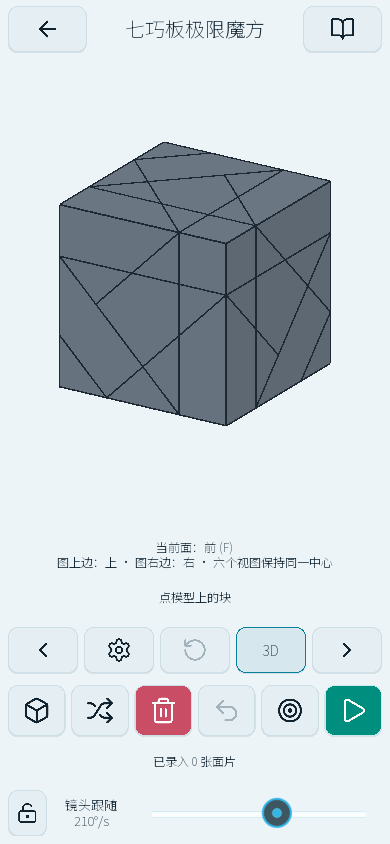
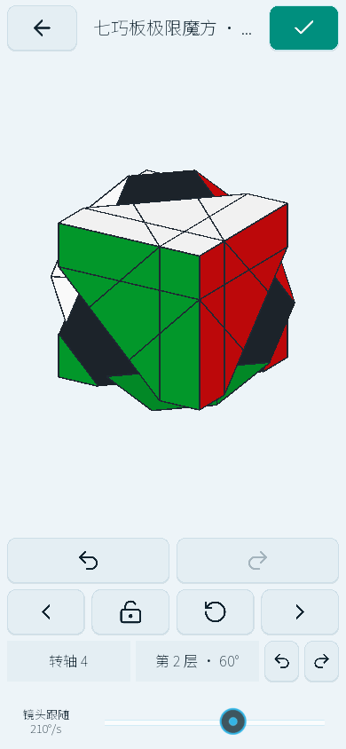
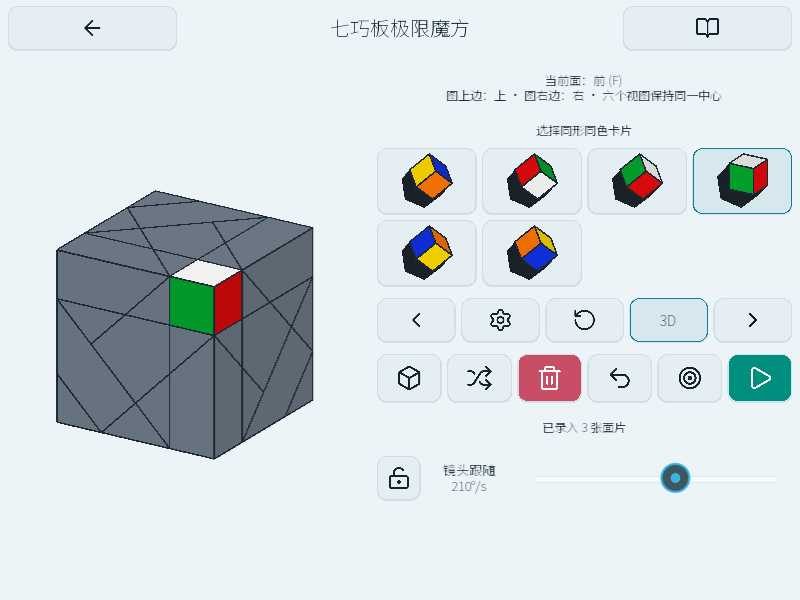

# Tangram Extreme：pCubes 参考重建验证

2026-11-01。参考 `bin/pCubes/Puzzles/Other cubes/Mixed/Edge-Vertex/Tangram II.xml`，未执行外部程序。保留现有分类与公共操作界面。

44个可见实体，66个彩色面片，中层12面。主轴60°；中层带动可用棱轴，界面每次显示4条可用轴。

| 检查 | 结果 |
| --- | --- |
| 相关自动测试 | 109项通过 |
| 无历史重新录入 | 24例全部通过；6种子×30/100/300/1000步 |
| 轴相位覆盖 | 相位零11例，相位一13例 |
| 100～1000步打乱的解法 | 18例，156～285步，全部实际模型逐步回放还原 |
| 匹配与求解耗时 | 本机匹配最长0.204秒，求解最长0.344秒；不含回放 |
| 实际App流程 | 800×600与390×844均通过：中层转动、可用轴更新、撤销、播放及倒回 |
| 精确距离表 | 全抽象边一致性、下降邻居及配对闭合检查通过 |
| 完整性证书 | 精确回形稳定子与配色表一致；两相位6311112192种形状 |

`manual-results.json` 仅通过可见轮廓和颜色传递状态，不传原块编号、姿态或打乱历史。该批测试经过正式匹配器，随后使用实际实体模型回放；手机操作控件另由相关测试及实际App检查覆盖。

预览：

完整性与距离表证书保存在 `reports/solver-audit/2026-10-23/tangram-completeness-proof.json` 和 `tangram-shape-pattern-proof.json`（历史路径，内容已重新生成）。未打包，也没有Android真机测量；测试结果不替代实物内部轨道认证。

## 整块配色录入修复

选实体卡片原先只保存当前观察面的颜色，其他面继续显示灰色。现改为一次记录该实体的全部彩色表面；换配色、旋转或撤销也以整块为单位更新，其他实体的记录保留。相同正面颜色但侧面配色不同的实体在候选中分别保留；多视图投影即使重合，也按实际空间位置和所属实体区分。保存／恢复包含整块配色约束，自动记录的暂时隐藏面不会被误认为必须从该视图可见。

新增双色、三色块的实际卡片操作验证：草稿与渲染器都加载全部颜色，保存后仍保留，单次撤销清除整块。相关回归分两批69项、55项通过（含重叠用例），其中录入控件共13项。另用30/100/300/1000步、各6种子的24例状态，通过整块录入数据重新匹配并逐步回放，全部还原；记录为 `whole-piece-results.json`。

